# ⚡ Angular MFE Command Center

[](https://github.com/OWNER/ang-mfe-command-center/actions/workflows/ci.yml)

> An enterprise-grade Angular 22 Micro-Frontend (MFE) Command Center architected with Native Federation, esbuild Application Builder, Angular Signals, a framework-agnostic Web Component remote, and an Nx Monorepo.

---

> [!NOTE]
>
> ### 🚀 Phase 3 Completed & Verified
>
> This repository demonstrates a production-ready 5-app micro-frontend architecture:
>
> 1. **Shell Host (Port 4200)**: Layout, dynamic manifest resolution, RBAC route guards, theme engine, observability error boundary, and resilience fallback.
> 2. **Remote Tasks (Port 4201)**: Real-time Kanban board driven by Signals state store and role-aware task authoring (read-only viewer mode blocks create, delete, and status moves).
> 3. **Remote Analytics (Port 4202)**: Real-time telemetry dashboard with inline reactive SVG charts and `ReplaySubject` event-bus replay for late-mounted views.
> 4. **Remote Settings (Port 4203)**: Signal-based configuration form with unified `theme:changed` synchronization.
> 5. **Remote Widget (Port 4204)**: Framework-agnostic Web Component (`<mfe-pulse-widget>`, zero Angular) mounted on `/widget` via a thin `EventBusAdapter`.

---

## 🌐 Live Demo (Vercel Placeholders)

| Application          | Role              | Planned Production URL                      |
| :------------------- | :---------------- | :------------------------------------------ |
| **Shell (Host)**     | Orchestrator      | `https://<mfe-shell>.vercel.app`            |
| **Remote Tasks**     | Angular MFE       | `https://<mfe-remote-tasks>.vercel.app`     |
| **Remote Analytics** | Angular MFE       | `https://<mfe-remote-analytics>.vercel.app` |
| **Remote Settings**  | Angular MFE       | `https://<mfe-remote-settings>.vercel.app`  |
| **Remote Widget**    | Web Component MFE | `https://<mfe-remote-widget>.vercel.app`    |

---

## 📸 Screenshots & Demo

> _Placeholders: add screenshots or an animated GIF after deploying to Vercel._

- **Shell Overview & Live Event Bus Telemetry**: `docs/screenshots/shell-overview.png` _(placeholder)_
- **Remote Tasks Kanban Board (Architect vs. Viewer Read-Only)**: `docs/screenshots/remote-tasks.png` _(placeholder)_
- **Remote Analytics SVG Dashboard**: `docs/screenshots/remote-analytics.png` _(placeholder)_
- **Cross-Framework Web Component Pulse Widget (`/widget`)**: `docs/screenshots/remote-widget.png` _(placeholder)_

---

## 🏛️ Architecture Overview

The platform uses **Native Federation** (`@angular-architects/native-federation`) utilizing standard browser-native ES Modules (ESM) and Import Maps, avoiding Webpack lock-in and running directly on Angular's high-performance **esbuild Application Builder** (`@angular/build:application`), alongside a plain Custom Element remote (`remote-widget`) loaded as a standard ES module.

```mermaid
flowchart TD
    subgraph Host ["apps/shell (Port 4200)"]
        ShellRoot["Shell Root (AppComponent)"]
        Nav["Header & Nav (Theme, Mock Auth, Role Selector)"]
        AuthService["AuthService (implements AuthReader)"]
        RoleGuard["settingsRoleGuard (blocks viewer)"]
        ManifestLoader["Manifest Dynamic Resolver"]
        WidgetHost["WidgetHostComponent (EventBusAdapter)"]
        ErrorHandler["MfeGlobalErrorHandler -> ERROR_REPORTER_TOKEN"]
        Fallback["Remote Fallback & Retry Boundary"]
    end

    subgraph Remotes ["Micro-Frontend Remotes"]
        TasksMFE["apps/remote-tasks (Port 4201)<br/>Kanban Board / Signals Store<br/>Read-Only Viewer Adaptation"]
        AnalyticsMFE["apps/remote-analytics (Port 4202)<br/>Inline SVG Charts / Signals Store<br/>Replays Task Events"]
        SettingsMFE["apps/remote-settings (Port 4203)<br/>Signal Forms / Theme Sync<br/>Dispatches theme:changed"]
        WidgetMFE["apps/remote-widget (Port 4204)<br/>Plain Web Component (Shadow DOM)<br/>Zero Angular Dependency"]
    end

    subgraph SharedLibs ["libs/shared (Shared Core & Contracts)"]
        EventBus["@mfe/shared/event-bus<br/>Typed Singleton + ReplaySubject Buffer"]
        Contracts["@mfe/shared/contracts<br/>AuthReader, EventMap, ErrorReporter, EventBusAdapter"]
        Tokens["@mfe/shared/ui-tokens<br/>CSS Variables & Themes (Light/Dark)"]
    end

    ShellRoot --> Nav
    ShellRoot --> AuthService
    ShellRoot --> RoleGuard
    ShellRoot --> ManifestLoader
    ShellRoot --> ErrorHandler

    ManifestLoader -.->|"federation.manifest.json (Runtime)"| TasksMFE
    ManifestLoader -.->|"federation.manifest.json (Runtime)"| AnalyticsMFE
    ManifestLoader -.->|"Guarded by settingsRoleGuard"| SettingsMFE
    ManifestLoader -.->|"Missing / Offline Remote"| Fallback
    WidgetHost -.->|"Dynamic ESM import (widget-entry.js)"| WidgetMFE

    TasksMFE <-->|"task:created / task:status-changed"| EventBus
    AnalyticsMFE <-->|"onWithReplay(task:*)"| EventBus
    SettingsMFE <-->|"theme:changed"| EventBus
    ShellRoot <-->|"theme:changed"| EventBus
    WidgetHost <-->|"EventBusAdapter"| EventBus

    AuthService -.->|"Provides AUTH_READER_TOKEN"| Contracts
    TasksMFE -.->|"Injects AUTH_READER_TOKEN"| Contracts
    ErrorHandler -.->|"Uses ERROR_REPORTER_TOKEN"| Contracts
    ShellRoot --- Tokens
    TasksMFE --- Tokens
    AnalyticsMFE --- Tokens
    SettingsMFE --- Tokens
```



---

## 💡 Why MFE (and when NOT to)

Micro-frontend architecture delivers immense agility for the right organizational scale, but introduces distributed systems complexity. Here is the architectural rubric:

### ✅ When to choose Micro-Frontends

1. **Multiple Independent Teams**: Multiple cross-functional feature teams needing to develop, test, and release features into production independently without synchronization bottlenecks.
2. **Independent Deployability**: The ability to deploy a critical patch or feature to `remote-tasks` or `remote-analytics` in seconds without triggering a full rebuild, regression suite, or redeployment of `shell`.
3. **Decoupled Release Lifecycles**: Different cadence across operational business units (e.g. daily task tracker updates vs. monthly quarterly analytics overhauls).
4. **Resilient Failure Domains**: Outage or runtime failure in a non-critical remote (e.g. `remote-analytics`) degrades gracefully into a fallback card while the primary command center navigation remains responsive.

### ❌ When NOT to choose Micro-Frontends

1. **Single Small/Mid-sized Team**: If 2–6 developers build the entire platform, the overhead of module federation, version alignment, and manifest management will slow down delivery compared to a standard modularized Nx monorepo.
2. **Deeply Coupled UI Flows**: Workflows requiring shared complex transactional forms, step-by-step wizards, or tight synchronous state between components should remain in a single application module.
3. **Bandwidth-Critical Mobile Sites**: Even with shared singletons, multiple entrypoints and import maps have slightly more metadata overhead than a single tightly tree-shaken bundle.
4. **Lack of Governance**: Without strict interface contracts (`libs/shared/contracts`) and CI enforcement, federated remotes can easily diverge in styling or cause runtime incompatibilities.

---

## 📦 Tech Stack

| Technology                 | Selection                                         | Architecture Justification                                                                                                                          |
| :------------------------- | :------------------------------------------------ | :-------------------------------------------------------------------------------------------------------------------------------------------------- |
| **Framework**              | Angular 22 (Latest)                               | Standalone components, Signal-based reactivity, signal forms, and control flow syntax (`@if`, `@for`).                                              |
| **Federation Engine**      | `@angular-architects/native-federation` ^22.2.5   | Native ESM + Import Maps standard. Decouples micro-frontends from Webpack and compiles natively through `@angular/build:application` (esbuild).     |
| **Cross-Framework Remote** | Plain Web Component + Vite (`apps/remote-widget`) | Demonstrates framework-agnostic Custom Element + Shadow DOM integration on `/widget` without Angular runtime coupling.                              |
| **Monorepo Engine**        | Nx 24                                             | High-performance dependency graph, project isolation, task caching, and `nx affected` CI execution.                                                 |
| **Linter & Rules**         | ESLint 9 + `angular-eslint` + `@nx/eslint`        | Strict architectural boundaries (`@nx/enforce-module-boundaries`): remotes never import from each other or shell; only from `libs/shared/*`.        |
| **Unit Testing**           | Vitest 4 + `@analogjs/vite-plugin-angular`        | Fast Vite/jsdom testing environment with native TypeScript execution.                                                                               |
| **E2E Smoke Testing**      | Playwright 1.65                                   | Headless smoke suite covering shell navigation, theme switching, role guards, Web Component mounting, zero console errors, and fallback resilience. |
| **Design System**          | SCSS Tokens (`libs/shared/ui-tokens`)             | Zero third-party UI library bloat. Custom CSS custom properties with light/dark theme toggle support.                                               |
| **Inter-MFE Bus**          | `@mfe/shared/event-bus`                           | Decoupled typed pub/sub bus with `ReplaySubject` buffer for late-mounted remotes, shared as a Native Federation singleton.                          |
| **Observability**          | `ERROR_REPORTER_TOKEN` (`@mfe/shared/contracts`)  | Vendor-agnostic `ErrorReporter` interface with `ConsoleErrorReporter` default (Sentry-ready, zero vendor lock-in).                                  |

---

## ⚖️ Decisions & Trade-offs

### 1. Singleton Sharing Strategy

Native Federation leverages browser-native **Import Maps** generated at build/runtime. Shared packages are declared in `federation.config.mjs` across every Angular project:

- **Angular Core & RxJS**: Shared strictly as singletons. Multiple copies of `@angular/core` or `zone.js` within a single browser context trigger `NG0200` circular dependency errors and break the Angular Router outlet.
- **Workspace Path Mappings**: Internal monorepo libraries (e.g. `@mfe/shared/event-bus`) are mapped via `tsconfig.base.json` rather than published npm packages. Setting `requiredVersion: false` allows them to be shared as true singletons across all remotes.
- **Version Mismatches**: With `strictVersion: true`, if a remote requires an incompatible major version of Angular core, Native Federation halts execution of that remote and the shell renders `RemoteFallbackComponent` without compromising host stability.

### 2. Auth Propagation Architecture

Micro-frontends must not couple to host implementation details. Role-based access control (RBAC) uses **Inversion of Control**:

1. **Shared Contract (`libs/shared/contracts`)**: `UserRole`, `AuthReader`, and `AUTH_READER_TOKEN`.
2. **Shell Ownership**: `AuthService` in the shell implements `AuthReader` and provides itself as `AUTH_READER_TOKEN`.
3. **Shell Route Guard (`settingsRoleGuard`)**: Intercepts `/settings` for `viewer` and redirects to `/access-denied`.
4. **Remote Adaptation**: `remote-tasks` injects `AUTH_READER_TOKEN` and hides/blocks create, delete, and status move controls when `isViewer()` is true.

### 3. Event Bus Design & Replay

Cross-remote communication uses `@mfe/shared/event-bus` bound to `EventMap`:

- **Unified Theme Contract**: Theme synchronization uses a single `'theme:changed'` (`'light' | 'dark'`) contract across shell, `remote-settings`, and `remote-widget`.
- **Replay Buffer for Lazy Remotes**: `EventBusService` maintains a bounded `ReplaySubject` (`onWithReplay()`) so lazy-loaded remotes like `remote-analytics` receive task events dispatched before they were mounted.

### 4. Trade-offs of Mixing Frameworks (`remote-widget` Web Component)

`apps/remote-widget` is built as a plain Custom Element (`<mfe-pulse-widget>`) with Shadow DOM and zero Angular dependencies, mounted by `WidgetHostComponent` on `/widget`:

- **Pros**:
  - **True Framework Independence**: Can be built with Vite, Lit, React, or vanilla DOM and deployed independently without Angular version lock-in.
  - **Style Encapsulation**: Shadow DOM isolates widget styles from host global CSS.
  - **Minimal Bundle Size**: Zero Angular runtime or Zone.js overhead.
- **Cons / Trade-offs**:
  - **Manual Adapter Layer**: Cannot use Angular DI (`inject()`) or `EventBusService` directly; requires `WidgetHostComponent` to bridge via `EventBusAdapter`.
  - **No Shared Router/Form Context**: Deep linking or Angular reactive forms inside the widget require custom attribute/event plumbing.
  - **Theming Friction**: Shadow DOM blocks global utility classes; theme state must be passed explicitly via the adapter or CSS custom properties.

### 5. Environment-Aware Manifest & Production CORS

- **Environment-Aware Manifest (`apps/shell/src/main.ts`)**:
  - `localhost` / `127.0.0.1` / `*.local` loads `federation.manifest.json` (`4201`, `4202`, `4203`).
  - Deployed environments load `federation.manifest.prod.json` pointing to the Vercel production URLs (with optional `window.__MFE_MANIFEST_URL__` override).
- **Restricted Production CORS**: Each remote's `vercel.json` restricts `Access-Control-Allow-Origin` to `https://mfe-shell.vercel.app`, disables long-term caching on `remoteEntry.json` / manifests (`no-cache, no-store, must-revalidate`), and caches hashed chunks (`*-<hash>.js|mjs|css`) immutably.

---

## 🔒 Security Notes

> [!IMPORTANT]
> **Client-Side RBAC Is a UX Demo Only**: The role switcher, `AuthService`, `settingsRoleGuard`, and `remote-tasks` read-only viewer mode exist solely to demonstrate micro-frontend authorization boundaries and UX adaptation. Client-side JavaScript can always be inspected or bypassed in DevTools. Real authentication (OIDC/JWT/HTTP-only session cookies) and authorization enforcement **must** live on the backend APIs.

---

## 🚀 Local Development

### Prerequisites

- Node.js 22.x or 24.x
- npm 10+

### 1. Installation

```bash
npm install
```

### 2. Start All 5 Applications Concurrently

```bash
# Starts Shell (4200), Tasks (4201), Analytics (4202), Settings (4203), and Widget (4204)
npm run start:all
```

Alternatively, start apps individually:

```bash
npm run start:shell             # http://localhost:4200
npm run start:remote-tasks      # http://localhost:4201
npm run start:remote-analytics  # http://localhost:4202
npm run start:remote-settings   # http://localhost:4203
npm run start:remote-widget     # http://localhost:4204
```

### 3. Command Center Navigation

| Route                 | Micro-Frontend Loaded | Description                                                                   |
| :-------------------- | :-------------------- | :---------------------------------------------------------------------------- |
| **`/`**               | Host Shell            | System cluster overview, cluster health cards, real-time EventBus feed        |
| **`/tasks`**          | `remote-tasks`        | Kanban task management board (role-sensitive)                                 |
| **`/analytics`**      | `remote-analytics`    | Real-time task throughput and status distribution charts                      |
| **`/settings`**       | `remote-settings`     | User profile, notification preferences, and theme synchronization             |
| **`/widget`**         | `remote-widget`       | Framework-agnostic Web Component (`<mfe-pulse-widget>`) via `EventBusAdapter` |
| **`/access-denied`**  | Host Shell            | Route guard fallback when role is restricted (e.g. `viewer`)                  |
| **`/missing-remote`** | Host Shell            | Resilient fallback boundary demonstration                                     |

---

## 🧪 Testing & Quality Gates

```bash
# 1. Code Formatting Check (Prettier)
npm run format:check

# 2. Architectural Linting & Module Boundary Rules (ESLint 9)
npm run lint:all

# 3. Unit Tests across all projects (Vitest)
npm run test:all

# 4. Playwright End-to-End Smoke Tests (all 5 apps)
npm run test:e2e

# 5. Production Builds for all 5 applications
npm run build:all

# 6. Post-deploy Remote Entrypoint Health Check
npm run check:remotes
```

---

## ▲ Deploying to Vercel

This repository deploys as **5 independent Vercel projects** connected to GitHub via Vercel's native Git integration (no Vercel deploy tokens or secrets are stored in this repository; GitHub Actions is used strictly for `lint`, `test`, `build`, and `e2e`).

### Recommended Deploy Order

1. Deploy the **remotes first**: `remote-tasks`, `remote-analytics`, `remote-settings`, `remote-widget`.
2. Deploy **`shell` last** so `federation.manifest.prod.json` resolves live remote entrypoints immediately.
3. Run `npm run check:remotes` to verify every `remoteEntry.json` endpoint returns HTTP `200` with valid JSON.

### Per-Project Vercel Dashboard Settings

Create each project manually in the Vercel Dashboard pointing to the same Git repository with the settings below.

> [!IMPORTANT]
> **Enable "Include source files outside of the Root Directory"** in **Project Settings → General** for all 5 projects so Nx can resolve `libs/shared/*`, `tsconfig.base.json`, `nx.json`, and root `package.json`.

| Vercel Project             | Root Directory          | Install Command | Build Command                               | Output Directory                           | Ignored Build Step                                   |
| :------------------------- | :---------------------- | :-------------- | :------------------------------------------ | :----------------------------------------- | :--------------------------------------------------- |
| **`mfe-shell`**            | `apps/shell`            | `npm ci`        | `cd ../.. && npx nx build shell`            | `../../dist/apps/shell/browser`            | `git diff HEAD^ HEAD --quiet -- . ../../libs/shared` |
| **`mfe-remote-tasks`**     | `apps/remote-tasks`     | `npm ci`        | `cd ../.. && npx nx build remote-tasks`     | `../../dist/apps/remote-tasks/browser`     | `git diff HEAD^ HEAD --quiet -- . ../../libs/shared` |
| **`mfe-remote-analytics`** | `apps/remote-analytics` | `npm ci`        | `cd ../.. && npx nx build remote-analytics` | `../../dist/apps/remote-analytics/browser` | `git diff HEAD^ HEAD --quiet -- . ../../libs/shared` |
| **`mfe-remote-settings`**  | `apps/remote-settings`  | `npm ci`        | `cd ../.. && npx nx build remote-settings`  | `../../dist/apps/remote-settings/browser`  | `git diff HEAD^ HEAD --quiet -- . ../../libs/shared` |
| **`mfe-remote-widget`**    | `apps/remote-widget`    | `npm ci`        | `cd ../.. && npx nx build remote-widget`    | `../../dist/apps/remote-widget/browser`    | `git diff HEAD^ HEAD --quiet -- . ../../libs/shared` |

_(If your Vercel domain for `shell` differs from `https://mfe-shell.vercel.app`, update `Access-Control-Allow-Origin` in each remote's `vercel.json` and the remote URLs in `apps/shell/public/federation.manifest.prod.json`.)_

### Vercel Preview Deployments Behavior & Limitations

- **Hostname & Manifest Selection**: Vercel Preview Deployments receive unique per-branch/per-commit URLs (`https://<project>-git-<branch>-<team>.vercel.app`). Because `apps/shell/src/main.ts` only treats `localhost` / `127.0.0.1` / `*.local` as local, a preview `shell` loads `federation.manifest.prod.json` (pointing to production remotes) unless `window.__MFE_MANIFEST_URL__` is injected.
- **Cross-Origin CORS on Previews**: Production remotes restrict `Access-Control-Allow-Origin` to `https://mfe-shell.vercel.app`. A preview `shell` on a different `*.vercel.app` origin will be blocked by browser CORS from loading production remotes.
- **Deployment Protection**: If Vercel Deployment Protection (Vercel Auth / Password Protection) is enabled on preview remotes, cross-origin `fetch()` / `import()` requests for `remoteEntry.json` will fail with `401` unless protection is disabled for remote entrypoints or a bypass header is configured.

---

## 🛠️ What I'd Do Differently in Production

1. **Polyrepo Split at Team Scale**: Once teams exceed ~3–4 independent squads, split remotes into separate repositories so CI pipelines, release cadences, and ownership boundaries are completely decoupled.
2. **Versioned Shared Contracts**: Publish `@mfe/shared/contracts` and `@mfe/shared/ui-tokens` as semver-versioned private npm packages rather than monorepo path aliases.
3. **Automated Contract Testing**: Add consumer-driven contract tests (e.g., Pact or JSON Schema / TypeScript compatibility checks in CI) for `EventMap` payloads and `AuthReader` interfaces.
4. **Backend-Enforced Auth (BFF)**: Replace client-side mock auth with a Backend-for-Frontend (OIDC + HTTP-only cookies) and server-side RBAC on every API endpoint.
5. **Shared Library Versioning & Canary Manifests**: Serve versioned `federation.manifest.json` from a config service supporting canary rollouts and instant rollback per remote.

---

## 🗺️ Roadmap

- [x] **Phase 1: Foundation & Core MFE**
  - [x] Nx monorepo workspace scaffolding with npm
  - [x] Shared UI design tokens (`libs/shared/ui-tokens`), typed contracts (`libs/shared/contracts`), and singleton EventBus (`libs/shared/event-bus`)
  - [x] Host Shell (`apps/shell`) and Remote Tasks (`apps/remote-tasks`) with fallback & retry UI
  - [x] Vitest 4 unit tests & GitHub Actions `nx affected` CI
- [x] **Phase 2: Analytics, Settings & Shared Auth Flow**
  - [x] ESLint 9 + `@nx/enforce-module-boundaries`
  - [x] `apps/remote-analytics` & `apps/remote-settings`
  - [x] `AUTH_READER_TOKEN`, `settingsRoleGuard`, and viewer read-only mode
  - [x] Playwright E2E smoke suite
- [x] **Phase 3: Production Operations & Cross-Framework Stretch**
  - [x] Vercel per-app deployment configs (`vercel.json`) with restricted CORS, cache headers, and `check:remotes` health check
  - [x] `EventBusService` `ReplaySubject` buffer for late-mounted `remote-analytics`
  - [x] Unified `theme:changed` contract & full viewer read-only enforcement on status moves
  - [x] Observability `ErrorReporter` contract (`ConsoleErrorReporter` + `MfeGlobalErrorHandler`)
  - [x] Cross-framework Web Component remote (`apps/remote-widget`) mounted on `/widget` via `EventBusAdapter`
