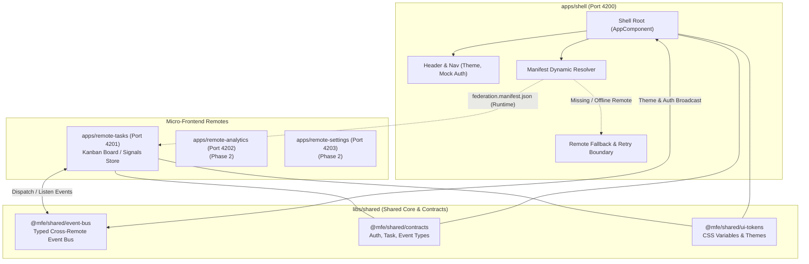

# ⚡ Angular MFE Command Center

> An enterprise-grade Angular 22 Micro-Frontend (MFE) Command Center architected with Native Federation, esbuild Application Builder, Angular Signals, and an Nx Monorepo.

---

> [!WARNING]
>
> ### 🚧 Work in progress
>
> This repository is actively under development. **Phase 1 (Core Foundation, Host Shell, and Tasks Remote)** is complete. See the [Roadmap](#-roadmap) below for Phase 2 and Phase 3 milestones.

---

## 🏛️ Architecture Overview

The system employs **Native Federation** (`@angular-architects/native-federation`) utilizing standard browser-native ES Modules (ESM) and Import Maps, avoiding legacy Webpack lock-in and running directly on Angular's high-performance **esbuild Application Builder** (`@angular/build:application`).



---

## 💡 Why MFE (and when NOT to)

Micro-frontend architecture delivers immense agility for the right organizational scale, but introduces distributed systems complexity. Here is the architectural rubric:

### ✅ When to choose Micro-Frontends

1. **Multiple Independent Teams**: Multiple cross-functional feature teams needing to develop, test, and release features into production independently without synchronization bottlenecks.
2. **Independent Deployability**: The ability to deploy a critical patch or feature to `remote-tasks` in seconds without triggering a full rebuild, regression suite, or redeployment of `shell`.
3. **Decoupled Release Lifecycles**: Different cadence across operational business units (e.g. daily task tracker updates vs. monthly quarterly analytics overhauls).
4. **Resilient Failure Domains**: Outage or runtime failure in a non-critical remote (e.g. `remote-analytics`) degrades gracefully into a fallback card while the primary command center navigation remains responsive.

### ❌ When NOT to choose Micro-Frontends

1. **Single Small/Mid-sized Team**: If 2–6 developers build the entire platform, the overhead of module federation, version alignment, and manifest management will slow down delivery compared to a standard modularized Nx monorepo.
2. **Deeply Coupled UI Flows**: Workflows requiring shared complex transactional forms, step-by-step wizards, or tight synchronous state between components should remain in a single application module.
3. **Bandwidth-Critical Mobile Sites**: Even with shared singletons, multiple entrypoints and import maps have slightly more metadata overhead than a single tightly tree-shaken bundle.
4. **Lack of Governance**: Without strict interface contracts (`libs/shared/contracts`) and CI enforcement, federated remotes can easily diverge in styling or cause runtime incompatibilities.

---

## 📦 Tech Stack & Decisions

| Technology            | Selection                                       | Architecture Justification                                                                                                                                 |
| :-------------------- | :---------------------------------------------- | :--------------------------------------------------------------------------------------------------------------------------------------------------------- |
| **Framework**         | Angular 22 (Latest)                             | Modern standalone components, Signal-based reactivity, and control flow syntax (`@if`, `@for`).                                                            |
| **Federation Engine** | `@angular-architects/native-federation` ^22.2.5 | Native ESM + Import Maps standard. Completely decouples micro-frontends from Webpack and compiles natively through `@angular/build:application` (esbuild). |
| **Monorepo Engine**   | Nx 24                                           | High-performance dependency graph, project isolation, task caching, and `nx affected` CI execution.                                                        |
| **Testing**           | Vitest 4 + `@analogjs/vite-plugin-angular`      | Lightning-fast JIT/Vite testing environment with native TypeScript execution and coverage.                                                                 |
| **Design System**     | SCSS Tokens (`libs/shared/ui-tokens`)           | Zero third-party UI library bloat. Custom CSS custom properties with full light/dark theme toggle support.                                                 |
| **Inter-MFE Bus**     | `@mfe/shared/event-bus`                         | Decoupled typed publish/subscribe bus with window singleton safeguarding and Angular Signals bridge.                                                       |

---

## 🔄 Dependency Sharing & Version Mismatch Strategy

In Native Federation, dependencies are configured in `federation.config.mjs` with:

```javascript
shared: {
  ...shareAll({
    singleton: true,
    strictVersion: true,
    requiredVersion: 'auto',
    includeSecondaries: true,
  }),
},
features: {
  denseExternals: true,
}
```

### Singletons

- `@angular/core`, `@angular/common`, `@angular/router`, and `rxjs` are shared strictly as **singletons**. Multiple copies of `@angular/core` or `zone.js` in a single window context cause runtime `NG0200` provider exceptions and break router outlets.

### Version Mismatches

1. `strictVersion: true`: If a remote is deployed requiring an incompatible major version of Angular core, the Native Federation orchestrator halts loading the mismatched remote and triggers the Shell's `RemoteFallbackComponent` rather than corrupting host memory.
2. `denseExternals: true`: Consolidates secondary entry points and shared externals to prevent redundant bundle chunk duplication across remote boundaries.
3. **Window Singleton Bridge**: The event bus implements a dual-layer resolution (`window.__MFE_GLOBAL_EVENT_BUS__`) guaranteeing that even if build isolation duplicated service references, events transmit seamlessly across the exact same runtime stream.

---

## 🚀 Local Development

### Prerequisites

- Node.js 22.x or 24.x
- npm 10+

### 1. Installation

```bash
npm install
```

### 2. Start Both Shell and Remote Concurrently

```bash
# Starts shell on http://localhost:4200 and remote-tasks on http://localhost:4201
npm run start:all
```

Alternatively, start apps individually in separate terminals:

```bash
# Terminal 1: Shell (Host)
nx serve shell --port 4200

# Terminal 2: Remote Tasks (MFE)
nx serve remote-tasks --port 4201
```

### 3. Open in Browser

- **Command Center Dashboard**: [http://localhost:4200](http://localhost:4200)
- **Tasks Board Remote (Federated)**: [http://localhost:4200/tasks](http://localhost:4200/tasks)
- **Tasks Board Remote (Standalone)**: [http://localhost:4201](http://localhost:4201)
- **Graceful Fallback Simulation**: [http://localhost:4200/missing-remote](http://localhost:4200/missing-remote)

---

## 🧪 Testing & Quality Gates

Run all unit tests across all libraries and applications with Vitest:

```bash
# Run all tests
npm run test:all

# Run lint formatting checks
npm run lint:all

# Check formatting
npm run format:check
```

---

## 🌐 Netlify Deployment Readiness

Each application is equipped with an independent `netlify.toml` enabling per-remote continuous deployment:

- **`apps/shell/netlify.toml`**: Configures publish directory `dist/apps/shell/browser` with SPA catch-all redirect rule (`/* -> /index.html 200`).
- **`apps/remote-tasks/netlify.toml`**: Configures publish directory `dist/apps/remote-tasks/browser`, SPA redirect, and crucial CORS headers (`Access-Control-Allow-Origin: *`) allowing the shell to fetch `remoteEntry.json` across domains.

---

## 🗺️ Roadmap

- [x] **Phase 1: Foundation & Core MFE (Current)**
  - [x] Nx monorepo workspace scaffolding with npm
  - [x] Shared UI design tokens library (`libs/shared/ui-tokens`) with light/dark theme engine
  - [x] Shared typed event contracts & auth interface (`libs/shared/contracts`)
  - [x] Decoupled cross-remote typed event bus (`libs/shared/event-bus`)
  - [x] Host Shell (`apps/shell`) with manifest dynamic resolution (`federation.manifest.json`)
  - [x] Remote Tasks (`apps/remote-tasks`) Kanban board with pure Angular Signals state management
  - [x] Resilient runtime fallback UI with in-place retry capabilities
  - [x] Vitest 4 suite with `@analogjs/vite-plugin-angular`
  - [x] GitHub Actions CI pipeline using `nx affected`
  - [x] Netlify deployment descriptors with CORS headers
- [ ] **Phase 2: Analytics, Settings & Shared Auth Flow**
  - [ ] `apps/remote-analytics`: Chart widgets and throughput telemetry fed by mock real-time APIs
  - [ ] `apps/remote-settings`: Profile management, team RBAC, and notification preferences form
  - [ ] Centralized authentication flow with refresh token synchronization over EventBus
- [ ] **Phase 3: Production Operations & Cross-Framework Stretch**
  - [ ] Independent CI/CD publishing to separate Netlify site instances per remote
  - [ ] Distributed telemetry and remote error monitoring hooks (Sentry/OpenTelemetry)
  - [ ] Stretch remote built in another framework (React/Svelte) wrapped as an interoperable Web Component
