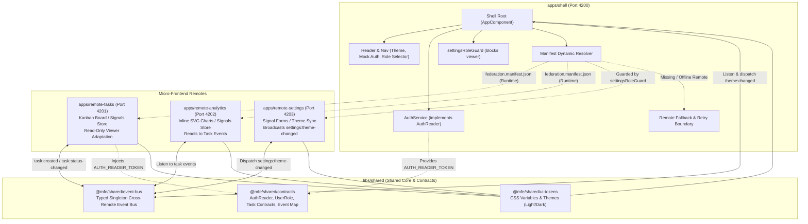

# ⚡ Angular MFE Command Center

> An enterprise-grade Angular 22 Micro-Frontend (MFE) Command Center architected with Native Federation, esbuild Application Builder, Angular Signals, and an Nx Monorepo.

---

> [!NOTE]
>
> ### 🚀 Phase 2 Completed & Verified
>
> This repository demonstrates a production-grade 4-tier micro-frontend architecture:
>
> 1. **Shell Host (Port 4200)**: Layout, dynamic manifest resolution, RBAC route guards, theme engine, and resilience fallback boundary.
> 2. **Remote Tasks (Port 4201)**: Real-time Kanban board driven by Signals state store and role-aware task authoring.
> 3. **Remote Analytics (Port 4202)**: Real-time telemetry dashboard with inline reactive SVG charts fed by mock APIs and synchronized via EventBus.
> 4. **Remote Settings (Port 4203)**: Signal-based configuration form with cross-remote theme synchronization.
>
> See the [Roadmap](#-roadmap) below for Phase 3 milestones.

---

## 🏛️ Architecture Overview

The platform uses **Native Federation** (`@angular-architects/native-federation`) utilizing standard browser-native ES Modules (ESM) and Import Maps, avoiding Webpack lock-in and running directly on Angular's high-performance **esbuild Application Builder** (`@angular/build:application`).



---

## 💡 Why MFE (and when NOT to)

Micro-frontend architecture delivers immense agility for the right organizational scale, but introduces distributed systems complexity. Here is the architectural rubric:

### ✅ When to choose Micro-Frontends

1. **Multiple Independent Teams**: Multiple cross-functional feature teams needing to develop, test, and release features into production independently without synchronization bottlenecks.
2. **Independent Deployability**: The ability to deploy a critical patch or feature to `remote-tasks` or `remote-analytics` in seconds without triggering a full rebuild, regression suite, or redeployment of `shell`.
3. **Decoupled Release Lifecycles**: Different cadence across operational business units (e.g. daily task tracker updates vs. monthly quarterly analytics overhauls).
4. **Resilient Failure Domains**: Outage or runtime failure in a non-critical remote (e.g. `remote-analytics`) degrades gracefully into a fallback card while the primary command center navigation remains responsive.

### ❌ When NOT to choose Micro-Frontends

1. **Single Small/Mid-sized Team**: If 2–6 developers build the entire platform, the overhead of module federation, version alignment, and manifest management will slow down delivery compared to a standard modularized Nx monorepo.
2. **Deeply Coupled UI Flows**: Workflows requiring shared complex transactional forms, step-by-step wizards, or tight synchronous state between components should remain in a single application module.
3. **Bandwidth-Critical Mobile Sites**: Even with shared singletons, multiple entrypoints and import maps have slightly more metadata overhead than a single tightly tree-shaken bundle.
4. **Lack of Governance**: Without strict interface contracts (`libs/shared/contracts`) and CI enforcement, federated remotes can easily diverge in styling or cause runtime incompatibilities.

---

## 📦 Tech Stack

| Technology            | Selection                                       | Architecture Justification                                                                                                                                 |
| :-------------------- | :---------------------------------------------- | :--------------------------------------------------------------------------------------------------------------------------------------------------------- |
| **Framework**         | Angular 22 (Latest)                             | Standalone components, Signal-based reactivity, signal forms, and control flow syntax (`@if`, `@for`).                                                     |
| **Federation Engine** | `@angular-architects/native-federation` ^22.2.5 | Native ESM + Import Maps standard. Completely decouples micro-frontends from Webpack and compiles natively through `@angular/build:application` (esbuild). |
| **Monorepo Engine**   | Nx 24                                           | High-performance dependency graph, project isolation, task caching, and `nx affected` CI execution.                                                        |
| **Linter & Rules**    | ESLint 9 + `angular-eslint` + `@nx/eslint`      | Strict architectural boundaries (`@nx/enforce-module-boundaries`): remotes never import from each other or shell; only from `libs/shared/*`.               |
| **Unit Testing**      | Vitest 4 + `@analogjs/vite-plugin-angular`      | Lightning-fast JIT/Vite testing environment with native TypeScript execution and coverage.                                                                 |
| **E2E Smoke Testing** | Playwright 1.65                                 | Headless smoke test suite covering shell navigation, theme switching, role guards, and remote fallback resilience under network failure.                   |
| **Design System**     | SCSS Tokens (`libs/shared/ui-tokens`)           | Zero third-party UI library bloat. Custom CSS custom properties with full light/dark theme toggle support.                                                 |
| **Inter-MFE Bus**     | `@mfe/shared/event-bus`                         | Decoupled typed publish/subscribe bus shared as a Native Federation singleton across all remote contexts.                                                  |
| **Visualizations**    | Custom Reactive Inline SVG                      | Zero chart library dependencies. Lightweight, high-performance SVG bars and donuts directly synchronized with Angular Signal stores.                       |

---

## ⚖️ Decisions & Trade-offs

### 1. Singleton Sharing Strategy

Native Federation leverages browser-native **Import Maps** generated at build/runtime. Shared packages are declared in `federation.config.mjs` across every project:

```javascript
shared: {
  ...shareAll({
    singleton: true,
    strictVersion: true,
    requiredVersion: 'auto',
    includeSecondaries: true,
  }),
  '@mfe/shared/event-bus': {
    singleton: true,
    strictVersion: false,
    requiredVersion: false,
  },
  '@mfe/shared/contracts': {
    singleton: true,
    strictVersion: false,
    requiredVersion: false,
  },
},
features: {
  denseExternals: true,
}
```

- **Angular Core & RxJS**: Shared strictly as singletons. Multiple copies of `@angular/core` or `zone.js` within a single browser context trigger `NG0200` circular dependency errors and break the Angular Router outlet.
- **Workspace Path Mappings**: Internal monorepo libraries (e.g. `@mfe/shared/event-bus`) are mapped via `tsconfig.base.json` rather than published npm packages. Setting `requiredVersion: false` prevents Native Federation from attempting to look up these packages in `package.json`, allowing them to be shared as true singletons across all remotes.
- **Version Mismatches**: With `strictVersion: true`, if a remote requires an incompatible major version of Angular core, Native Federation halts execution of that remote and the shell renders the graceful `RemoteFallbackComponent` without compromising host stability.

### 2. Auth Propagation Architecture

Micro-frontends must not couple to host implementation details. We solved role-based access control (RBAC) via **Inversion of Control**:

1. **Shared Contract (`libs/shared/contracts`)**:
   - `UserRole`: `'architect' | 'admin' | 'developer' | 'viewer'`.
   - `AuthReader`: Read-only interface exposing `currentUser`, `isAuthenticated`, `role`, and helper methods (`canAccessSettings()`, `canModifyTasks()`).
   - `AUTH_READER_TOKEN`: Injection token for remotes to read-only consume authentication state.
2. **Shell Ownership**: The shell owns user credentials, token lifecycle, and role switching. `AuthService` in the shell implements `AuthReader` and provides itself as `AUTH_READER_TOKEN`.
3. **Shell Route Guard (`settingsRoleGuard`)**: Enforces access boundaries at the router level. When an unauthorized user (e.g., `viewer`) attempts to navigate to `/settings`, the guard intercepts navigation and redirects to `/access-denied`.
4. **Remote Adaptation**: Remotes (such as `remote-tasks`) optionally inject `AUTH_READER_TOKEN`. If a `viewer` accesses the Kanban board, the UI displays a `READ-ONLY MODE` badge and disables all task creation and deletion controls. Remotes never import shell code directly.

### 3. Event Bus Design

Cross-remote communication uses an asynchronous publish/subscribe event bus (`@mfe/shared/event-bus`) bound to a strongly typed contract map (`TaskEventContractMap`):

- **Decoupled Architecture**: Remotes dispatch events (e.g., `task:created`, `task:status-changed`, `settings:theme-changed`) without knowing which remotes (or shell) are listening.
- **Elimination of Global Window Bridge**: In Phase 1, a `window.__MFE_GLOBAL_EVENT_BUS__` fallback was kept to guard against potential bundle duplication. In Phase 2, Native Federation's explicit `share()` configuration for `@mfe/shared/event-bus` was established and verified across all four applications. The import map resolves a single singleton instance of `EventBusService`, allowing complete removal of the `window` hack.

### 4. Lightweight SVG Charting vs. Heavy Chart Libraries

For `apps/remote-analytics`, rather than introducing heavy chart dependencies (e.g. Chart.js, Highcharts, or D3 at ~150-400 KB):

- **Inline SVG + Angular Signals**: Charts (Throughput Bar Chart, Status Donut Chart, and Metric Cards) are authored entirely in inline SVG and HTML controlled by `computed()` Signals.
- **Zero Overhead**: Adds 0 KB of third-party bundle weight and introduces zero supply-chain vulnerability surface.
- **Native CSS Token Theming**: SVG elements (`fill`, `stroke`) consume the design token CSS variables (`var(--color-primary)`, `var(--color-surface)`) directly, instantly reacting to theme toggles without canvas re-rendering or color synchronization logic.

### 5. Environment-Aware Manifest & Production CORS

- **Environment-Aware Manifest**: The shell resolves its federation manifest dynamically in `apps/shell/src/main.ts`:
  - Dev: Loads `/federation.manifest.json` pointing to `localhost:4201`, `localhost:4202`, and `localhost:4203`.
  - Prod: Loads `/federation.manifest.prod.json` with production CDN endpoints injected during build/deploy.
- **Restricted Production CORS**: In `netlify.toml` for each remote, production CORS headers are restricted to the shell origin:
  ```toml
  [[headers]]
    for = "/remoteEntry.json"
    [headers.values]
      Access-Control-Allow-Origin = "https://angular-mfe-command-center.netlify.app"
      Access-Control-Allow-Methods = "GET, OPTIONS"
  ```
  This prevents arbitrary third-party origins from embedding and executing remote script bundles.

---

## 🚀 Local Development

### Prerequisites

- Node.js 22.x or 24.x
- npm 10+

### 1. Installation

```bash
npm install
```

### 2. Start All 4 Applications Concurrently

```bash
# Starts Shell (4200), Tasks (4201), Analytics (4202), and Settings (4203)
npm run start:all
```

Alternatively, start apps individually in separate terminals:

```bash
# Host Shell
npm run start:shell             # http://localhost:4200

# Remotes
npm run start:remote-tasks       # http://localhost:4201
npm run start:remote-analytics   # http://localhost:4202
npm run start:remote-settings    # http://localhost:4203
```

### 3. Command Center Navigation

| Route                 | Micro-Frontend Loaded | Description                                                       |
| :-------------------- | :-------------------- | :---------------------------------------------------------------- |
| **`/`**               | Host Shell            | System cluster overview, cluster health cards, real-time metrics  |
| **`/tasks`**          | `remote-tasks`        | Kanban task management board (role-sensitive)                     |
| **`/analytics`**      | `remote-analytics`    | Real-time task throughput and status distribution charts          |
| **`/settings`**       | `remote-settings`     | User profile, notification preferences, and theme synchronization |
| **`/access-denied`**  | Host Shell            | Route guard fallback when role is restricted (e.g. `viewer`)      |
| **`/missing-remote`** | Host Shell            | Resilient fallback boundary demonstration                         |

---

## 🧪 Testing & Quality Gates

```bash
# 1. Code Formatting Check (Prettier)
npm run format:check

# 2. Architectural Linting & Module Boundary Rules (ESLint 9)
npm run lint:all

# 3. Unit Tests across all projects (Vitest)
npm run test:all

# 4. Playwright End-to-End Smoke Tests
npm run test:e2e

# 5. Production Builds for all 4 applications
npm run build:all
```

---

## 🌐 Netlify Deployment Readiness

Every application includes an independent `netlify.toml` enabling per-remote continuous deployment:

- **`apps/shell/netlify.toml`**: Configures publish directory `dist/apps/shell/browser` with SPA catch-all redirect rule (`/* -> /index.html 200`).
- **`apps/remote-tasks/netlify.toml`**: Configures publish directory `dist/apps/remote-tasks/browser`, SPA redirect, and production CORS headers.
- **`apps/remote-analytics/netlify.toml`**: Configures publish directory `dist/apps/remote-analytics/browser`, SPA redirect, and production CORS headers.
- **`apps/remote-settings/netlify.toml`**: Configures publish directory `dist/apps/remote-settings/browser`, SPA redirect, and production CORS headers.

---

## 🗺️ Roadmap

- [x] **Phase 1: Foundation & Core MFE**
  - [x] Nx monorepo workspace scaffolding with npm
  - [x] Shared UI design tokens library (`libs/shared/ui-tokens`) with light/dark theme engine
  - [x] Shared typed event contracts & auth interface (`libs/shared/contracts`)
  - [x] Decoupled cross-remote typed event bus (`libs/shared/event-bus`)
  - [x] Host Shell (`apps/shell`) with manifest dynamic resolution (`federation.manifest.json`)
  - [x] Remote Tasks (`apps/remote-tasks`) Kanban board with pure Angular Signals state management
  - [x] Resilient runtime fallback UI with in-place retry capabilities
  - [x] Vitest 4 suite with `@analogjs/vite-plugin-angular`
  - [x] GitHub Actions CI pipeline using `nx affected`
  - [x] Netlify deployment descriptors with CORS headers
- [x] **Phase 2: Analytics, Settings & Shared Auth Flow**
  - [x] ESLint 9 + `@nx/enforce-module-boundaries` architectural boundaries
  - [x] EventBus singleton via Native Federation Import Map (removed `window` bridge)
  - [x] Environment-aware manifest resolution & restricted production CORS
  - [x] MIT License
  - [x] `apps/remote-analytics`: Real-time telemetry dashboard with reactive inline SVG charts reacting to `task:created` and `task:status-changed` events
  - [x] `apps/remote-settings`: Signal-based configuration form with theme synchronization (`settings:theme-changed`)
  - [x] Shared Auth Flow: `AUTH_READER_TOKEN`, role permissions (`architect`, `admin`, `developer`, `viewer`), shell `settingsRoleGuard`, and read-only Kanban viewer mode
  - [x] Playwright smoke tests for shell remote loading, theme switching, role guards, and network fallback resilience
  - [x] Vitest unit test coverage for stores, guards, and event handling across all remotes
- [ ] **Phase 3: Production Operations & Cross-Framework Stretch**
  - [ ] Independent CI/CD publishing to separate Netlify site instances per remote
  - [ ] Distributed telemetry and remote error monitoring hooks (Sentry/OpenTelemetry)
  - [ ] Stretch remote built in another framework (React/Svelte) wrapped as an interoperable Web Component
